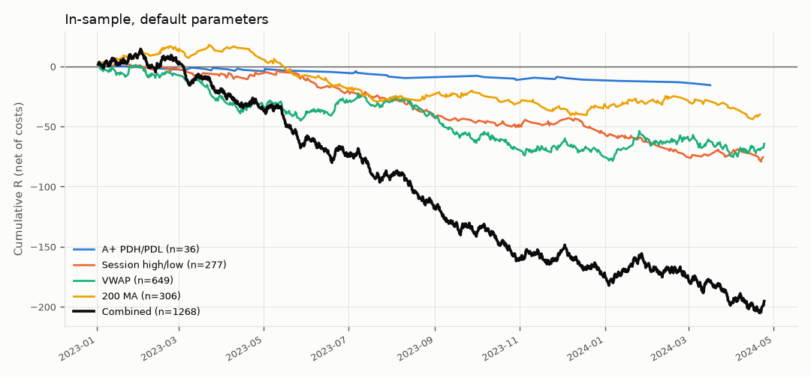
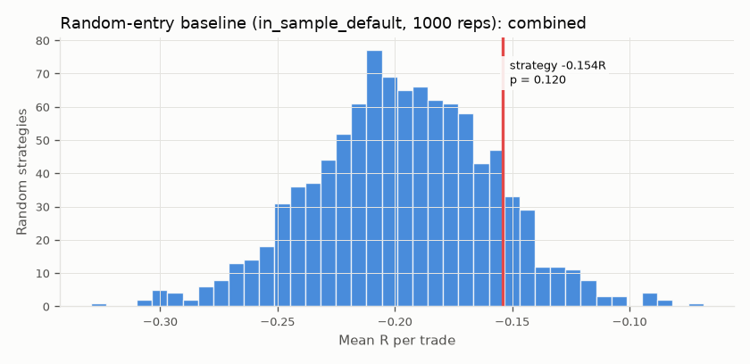
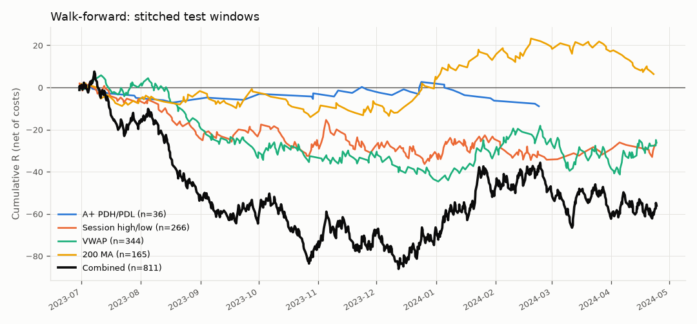
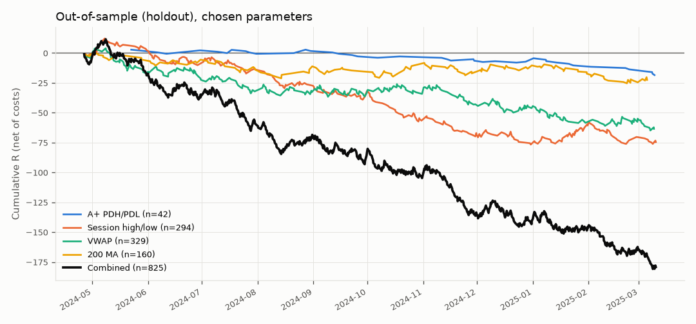
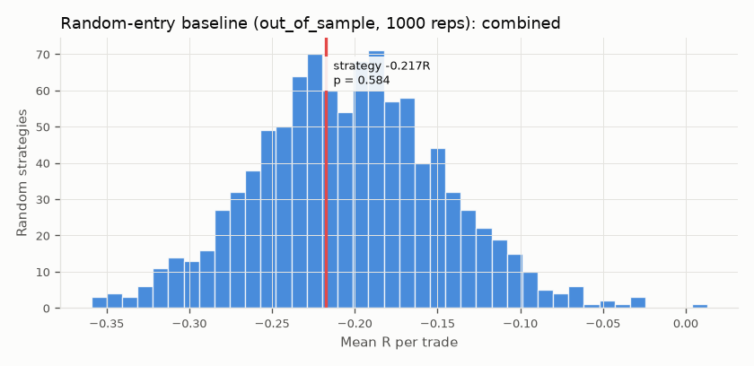

# Reversal strategy evaluation: BTCUSDT 5min

> **Synthetic data.** These bars are a random walk with no exploitable pattern by construction. Any apparent edge below is noise. The point of this report is to show the evaluation machinery, and that it correctly finds *nothing*.

## Data and design

- Bars: 230,400 × 5min, 2023-01-01 → 2025-03-10 (data fingerprint `2245b1a1a0c1`, config `f570f607d6ee`)
- Session: 00:00 UTC day boundary; entries 00:00–23:30; flatten at session end: True
- **In-sample (tuning):** 2023-01-01 → 2024-04-25.  **Out-of-sample (holdout):** 2024-04-25 → 2025-03-11
- Costs: slippage {'mode': 'pct', 'value': 0.0001}, commission {'mode': 'pct', 'value': 0.0005} per side; fills at next bar open; stop-first when a bar touches both stop and target
- Evidence threshold: 100 trades. Random baseline: 1000 repetitions.

## 1. In-sample, default (pre-specified) parameters

| Setup | Trades | Win rate [95% CI] | Expectancy R [95% CI] | Avg win / loss R | Profit factor | Max DD (R) | Longest losing streak | Costs per trade (R) | Expectancy before costs | Random-entry p | Evidence |
|---|---|---|---|---|---|---|---|---|---|---|---|
| A+ PDH/PDL | 36 | 25.0% [13.8%–41.1%] | -0.433 [-0.817, +0.004] | +1.726 / -1.152 | 0.50 | 16.19 | 6 | 0.16 | -0.272 | 0.92 | ⚠ INSUFFICIENT |
| Session high/low | 277 | 30.3% [25.2%–36.0%] | -0.273 [-0.425, -0.110] | +1.716 / -1.138 | 0.66 | 83.08 | 10 | 0.16 | -0.112 | 0.93 | OK (n≥min) |
| VWAP | 649 | 37.0% [33.4%–40.8%] | -0.099 [-0.208, +0.012] | +1.739 / -1.178 | 0.87 | 80.03 | 11 | 0.21 | +0.111 | 0.02 | OK (n≥min) |
| 200 MA | 306 | 36.6% [31.4%–42.1%] | -0.131 [-0.288, +0.032] | +1.750 / -1.216 | 0.83 | 61.93 | 12 | 0.23 | +0.094 | 0.12 | OK (n≥min) |
| Combined | 1268 | 35.1% [32.5%–37.8%] | -0.154 [-0.234, -0.077] | +1.737 / -1.177 | 0.80 | 219.69 | 16 | 0.20 | +0.047 | 0.12 | OK (n≥min) |

Signals rejected by filters (stop too tight/wide, target too close):

| Setup | Reason | Count |
|---|---|---|
| ma | stop_too_wide | 2 |
| pdh_pdl | stop_too_wide | 5 |
| session_extreme | stop_too_wide | 15 |
| vwap | stop_too_wide | 2 |

Orders cancelled between signal and fill:

_none_

## 2. Parameter search (in-sample only)

- Combinations evaluated in this run's grid: **18**
- Distinct configurations ever evaluated on this dataset's tuning data (ledger, incl. walk-forward): **18**
- Selection objective: `expectancy` with ≥30 trades

| setups.double.peak_tolerance.value | entry.trigger | exits.target.r_multiple | trades | expectancy_R | total_R | objective |
|---|---|---|---|---|---|---|
| 0.4 | neckline_break | 3.0 | 1230 | -0.078 | -95.901 | -0.078 |
| 0.15 | neckline_break | 3.0 | 1184 | -0.091 | -107.696 | -0.091 |
| 0.25 | neckline_break | 3.0 | 1212 | -0.107 | -129.813 | -0.107 |
| 0.4 | neckline_break | 2.0 | 1298 | -0.119 | -153.894 | -0.119 |
| 0.4 | close_back_through_level | 3.0 | 1382 | -0.130 | -179.212 | -0.130 |
| 0.4 | neckline_break | 1.5 | 1319 | -0.136 | -179.255 | -0.136 |
| 0.15 | neckline_break | 2.0 | 1235 | -0.140 | -172.752 | -0.140 |
| 0.25 | neckline_break | 2.0 | 1268 | -0.154 | -195.361 | -0.154 |
| 0.25 | close_back_through_level | 3.0 | 1359 | -0.159 | -215.910 | -0.159 |
| 0.15 | neckline_break | 1.5 | 1255 | -0.160 | -200.494 | -0.160 |

**Chosen:** `{'setups.double.peak_tolerance.value': 0.4, 'entry.trigger': 'neckline_break', 'exits.target.r_multiple': 3.0}`. Its in-sample expectancy (-0.078R) is the *best of many tries*, so expect it to be optimistic (selection bias / winner's curse).

## 3. Walk-forward analysis

Train 180d → test 60d, step 60d, span: in_sample. Each fold re-runs the grid on its training window and trades the winner on the next window.

| train_start | test_start | test_end | chosen:setups.double.peak_tolerance.value | chosen:entry.trigger | chosen:exits.target.r_multiple | train_trades | train_expectancy_R | test_trades | test_expectancy_R |
|---|---|---|---|---|---|---|---|---|---|
| 2023-01-01 | 2023-06-30 | 2023-08-29 | 0.4 | neckline_break | 2.0 | 475 | -0.115 | 164 | -0.281 |
| 2023-03-02 | 2023-08-29 | 2023-10-28 | 0.4 | neckline_break | 3.0 | 469 | -0.186 | 153 | -0.236 |
| 2023-05-01 | 2023-10-28 | 2023-12-27 | 0.4 | close_back_through_level | 3.0 | 523 | -0.158 | 171 | +0.049 |
| 2023-06-30 | 2023-12-27 | 2024-02-25 | 0.4 | close_back_through_level | 3.0 | 516 | -0.106 | 174 | +0.204 |
| 2023-08-29 | 2024-02-25 | 2024-04-25 | 0.15 | neckline_break | 3.0 | 439 | +0.050 | 149 | -0.119 |

Stitched test-window results:

| Setup | Trades | Win rate [95% CI] | Expectancy R [95% CI] | Avg win / loss R | Profit factor | Max DD (R) | Longest losing streak | Costs per trade (R) | Expectancy before costs | Random-entry p | Evidence |
|---|---|---|---|---|---|---|---|---|---|---|---|
| A+ PDH/PDL | 36 | 25.0% [13.8%–41.1%] | -0.248 [-0.783, +0.310] | +2.651 / -1.215 | 0.73 | 11.54 | 9 | 0.23 | -0.021 | – | ⚠ INSUFFICIENT |
| Session high/low | 266 | 29.7% [24.5%–35.4%] | -0.102 [-0.298, +0.103] | +2.392 / -1.156 | 0.87 | 38.29 | 9 | 0.21 | +0.107 | – | OK (n≥min) |
| VWAP | 344 | 30.8% [26.2%–35.9%] | -0.076 [-0.255, +0.108] | +2.464 / -1.208 | 0.91 | 51.02 | 11 | 0.24 | +0.166 | – | OK (n≥min) |
| 200 MA | 165 | 35.8% [28.8%–43.3%] | +0.038 [-0.224, +0.309] | +2.344 / -1.245 | 1.05 | 16.89 | 11 | 0.25 | +0.293 | – | OK (n≥min) |
| Combined | 811 | 31.2% [28.1%–34.5%] | -0.069 [-0.185, +0.049] | +2.420 / -1.198 | 0.92 | 93.69 | 18 | 0.23 | +0.164 | – | OK (n≥min) |

## 4. Out-of-sample holdout (evaluated once, parameters frozen)

| Setup | Trades | Win rate [95% CI] | Expectancy R [95% CI] | Avg win / loss R | Profit factor | Max DD (R) | Longest losing streak | Costs per trade (R) | Expectancy before costs | Random-entry p | Evidence |
|---|---|---|---|---|---|---|---|---|---|---|---|
| A+ PDH/PDL | 42 | 23.8% [13.5%–38.5%] | -0.441 [-0.836, +0.005] | +1.828 / -1.151 | 0.50 | 21.32 | 12 | 0.16 | -0.278 | 0.88 | ⚠ INSUFFICIENT |
| Session high/low | 294 | 25.5% [20.9%–30.8%] | -0.254 [-0.430, -0.069] | +2.335 / -1.140 | 0.70 | 88.78 | 20 | 0.17 | -0.080 | 0.87 | OK (n≥min) |
| VWAP | 329 | 27.7% [23.1%–32.7%] | -0.193 [-0.379, -0.002] | +2.542 / -1.239 | 0.78 | 68.86 | 9 | 0.25 | +0.059 | 0.34 | OK (n≥min) |
| 200 MA | 160 | 28.7% [22.3%–36.2%] | -0.141 [-0.396, +0.140] | +2.491 / -1.203 | 0.84 | 25.40 | 8 | 0.25 | +0.104 | 0.23 | OK (n≥min) |
| Combined | 825 | 26.9% [24.0%–30.0%] | -0.217 [-0.330, -0.103] | +2.430 / -1.192 | 0.75 | 192.35 | 15 | 0.22 | +0.001 | 0.58 | OK (n≥min) |

Where the strategy falls in the random-entry distribution:

| Setup | Strategy mean R | Random mean R | Random 5–95% | Percentile | p-value |
|---|---|---|---|---|---|
| A+ PDH/PDL | -0.441 | -0.158 | -0.537 to +0.234 | 11.90 | 0.88 |
| Session high/low | -0.254 | -0.155 | -0.299 to -0.008 | 13.50 | 0.87 |
| VWAP | -0.193 | -0.228 | -0.367 to -0.087 | 65.90 | 0.34 |
| 200 MA | -0.141 | -0.235 | -0.448 to -0.013 | 77.50 | 0.23 |
| Combined | -0.217 | -0.203 | -0.295 to -0.111 | 41.60 | 0.58 |

## 5. How to read this

- Out-of-sample combined: 825 trades, expectancy -0.217R (95% CI -0.330 to -0.103), random-entry p = 0.58.
- The CI for expectancy includes zero (or is below it): **no evidence of an edge**.
- Fewer than 100 trades (insufficient evidence, do not draw conclusions): A+ PDH/PDL.
- 18 configurations have been tried on this dataset. With that many tries, a best-of-grid in-sample result is expected to look better than it really is; only the walk-forward and holdout sections are honest estimates.
- 'Expectancy before costs' vs 'Expectancy' shows how much of the result fees and slippage consume. With 5-minute stops, costs are a large fraction of 1R.
